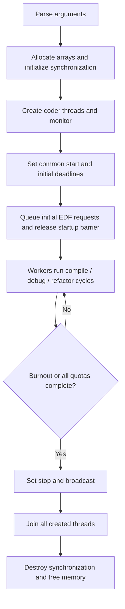

# How Codexion works

This guide explains the implementation in `src/`, from program startup to
cleanup. The assignment is defined by Codexion v1.5 in `../en.subject.pdf`.
Use [TESTING.md](TESTING.md) for commands and expected behavior, and
[REVIEW.md](REVIEW.md) for corrections and validation limits.

## 1. The problem

There are N coders around a circular table and N shared USB dongles. Each coder
needs both neighboring dongles to compile. After compiling, the coder releases
them, debugs, refactors, then immediately requests them again. Released dongles
remain unavailable for a cooldown period.

Every coder has a burnout deadline. If a coder does not start another compilation
before its deadline, the simulation stops. It also stops once all coders have
completed the required number of compilations.

This is a concurrency problem because separate threads compete for the same
resources. Correctness means preventing duplicate ownership, respecting priority
and cooldown, detecting missed deadlines, and shutting down without leaks.

## 2. Command-line arguments

```sh
./codexion 5 1000 20 20 20 10 80 edf
```

| Argument | Example | Meaning |
| --- | --- | --- |
| `number_of_coders` | 5 | Number of coder threads and dongles |
| `time_to_burnout` | 1000 | Deadline interval in milliseconds |
| `time_to_compile` | 20 | Time holding the pair during compilation |
| `time_to_debug` | 20 | Debug phase duration |
| `time_to_refactor` | 20 | Refactor phase duration |
| `number_of_compiles_required` | 10 | Minimum completed count for every coder before success |
| `dongle_cooldown` | 80 | Delay after release before reuse |
| `scheduler` | edf | `fifo` or `edf`, case-sensitive |

`parsing.c` requires exactly eight arguments. It accepts only decimal digits,
accumulates into a wider integer, and rejects values greater than `INT_MAX`.
It rejects signs, whitespace, fractions, empty arguments, and zero coders.
Zero durations and zero quota are accepted. No libft is used.

## 3. Data structures

| Structure | Responsibility and important fields |
| --- | --- |
| `t_config` | Immutable parsed configuration: count, timings, quota, policy |
| `t_heap` | Array of coder indices, current size, allocated capacity |
| `t_dongle` | Mutex, owner ID (`-1` means free), `ready_at`, request heap |
| `t_coder` | ID, neighboring indices, completed count, last start, pending request priority, thread, simulation pointer |
| `t_sim` | Configuration, arrays, synchronization objects, common start, stop flag, sequence counter, cleanup bookkeeping |

There are no application global variables. `main()` owns a `t_sim` and passes
pointers into threads. The object stays alive until all created threads have
been joined. Heap entries are zero-based coder indices; printed IDs start at 1.

## 4. The ring

For zero-based coder index `i`:

```text
left dongle  = i
right dongle = (i + 1) % N
printed ID  = i + 1
```

For five coders, coder 1 uses dongles 0 and 1, coder 2 uses 1 and 2, and coder 5
uses 4 and 0. Thus coder 1 and coder 5 are neighbors. Non-neighbors can compile
at the same time. With two coders, both compete for the same pair. With one
coder, both indices identify the same single dongle, handled by a special path.

## 5. Startup and shutdown



`init.c` zeroes state, initializes the shared mutexes and condition variable,
allocates coder/dongle arrays, and initializes each dongle's mutex and queue.
Flags and counters record which initialization steps succeeded.

`threads.c` creates one thread per coder plus one monitor. Threads wait until
`ready` is set. The main thread sets a common start time and gives every coder
the same initial `last_start`. For EDF it also registers all initial requests
before waking workers. For even-sized FIFO rings, `fifo_start.c` orders first
requests by odd IDs then even IDs. Workers wait until all first requests are
queued before acquiring resources. This prevents startup queue chains in the
reported ten-coder workload. Odd-sized FIFO rings retain ordinary arrival order.

If thread creation fails, the program sets `stop` and `ready`, wakes waiting
threads, joins all successfully created threads, then cleans up. With a zero
quota, it creates no threads and returns successfully after initialization.

## 6. A worker's cycle

`coder_thread()` in `worker.c` performs:

1. Wait for the startup barrier.
2. Request and acquire both dongles.
3. Wait for the compilation duration, interruptibly.
4. Release both dongles and start their cooldowns.
5. Check for overdue burnout, then count the completed compilation.
6. If all coders have reached the quota, stop; otherwise log debugging.
7. Wait for debugging, log refactoring, and wait for refactoring.
8. Immediately request again.

Counts saturate at the quota to avoid unnecessary growth. A coder reaching its
own quota continues participating until the global condition is met. It remains
subject to burnout. If a stop interrupts compilation, the worker still releases
its dongles, but does not count the interrupted compilation as complete.

With one coder, `single_coder_locked()` takes the only dongle once, logs it,
and waits for the monitor. It never pretends that one dongle is two.

## 7. FIFO and EDF heaps

Every dongle contains a binary min-heap. Its root is the highest-priority
pending request. At most two coders can request a particular dongle, so capacity
2 is enough: the two adjacent coders each have at most one pending request.

`heap_push()` appends and moves an entry upward until the parent has higher
priority. `heap_pop()` removes the root, moves the last entry to the root, and
sifts it downward. `heap_top()` reads the root or returns `-1` for an empty heap.
For a general heap of k entries, push/pop cost O(log k); here k is at most 2.

`heap_before()` defines the order:

| Policy | Comparison order |
| --- | --- |
| FIFO | Request sequence, then coder ID |
| EDF | Burnout deadline, then `edf_slot()`, then request sequence, then coder ID |

For example, A arrives before B but has deadline 500, while B has deadline 400.
FIFO prefers A; EDF prefers B. Equal EDF deadlines have a deterministic tie-break.
The request's deadline is captured when queued and does not change while waiting,
since that coder cannot start a compilation before the request is removed.

## 8. Initial EDF staggering

Simply letting whichever worker runs first acquire dongles can bunch compilation
starts and cause avoidable burnout on an odd ring with a long cooldown.

The program now queues **all** first EDF requests at the common simulation start.
Each first acquisition must also wait for its initial `edf_slot()`. Registering
requests before staggering matters: otherwise an already-running coder could
request again ahead of a neighbor whose first request had not yet been registered.

`init_schedule()` computes a spacing cycle from:

```text
half     = floor(N / 2)
resource = time_to_compile + dongle_cooldown
cycle    = max(ceil(resource * N / half),
               time_to_compile + time_to_debug + time_to_refactor)
```

It adds 4 ms only when the resulting cycle remains strictly below the burnout
interval. For coder ID `id`, its initial phase is:

```text
index = ((id - 1) * half) % N
phase = floor(cycle * index / N)
first eligible time = simulation_start + phase
```

For five coders with compilation 20 ms and cooldown 80 ms, and burnout 300 ms,
`cycle` is 254 ms. The order is 1, 4, 2, 5, 3, with initial phases approximately
0, 50, 101, 152 and 203 ms. This spreads resource demand around the ring.

The time gate applies only before a coder's **first** compilation. Later requests
are submitted immediately after refactoring and use ordinary heap arbitration.
`edf_slot()` also remains the equal-deadline tie-break, including the coder's
completed count; that use is a priority comparison, not a recurring time gate.
FIFO has no timed startup gate; even FIFO rings use the ordered admission
barrier described above. This EDF policy fixes the observed startup regression;
it is not a proof of deadline feasibility for every possible input.

## 9. Acquiring a pair safely

`acquire.c` enqueues a normal request on both heaps, then checks in a loop whether
it can be granted. Initial EDF requests are already queued by the main thread,
so the worker must not enqueue them a second time.

`grant.c` grants a request only when:

- Its own burnout deadline has not arrived.
- Its initial EDF time gate, if applicable, has passed.
- Both dongles are unowned.
- Both cooldowns have expired.
- The coder is at the root of both heaps.

It removes both heap roots, assigns both owners, updates `last_start`, then logs
two dongle acquisitions followed by compilation. It holds the simulation mutex
through the transaction, so no competing worker can alter the result between
the availability check and the ownership update. Dongle fields additionally use
the corresponding dongle mutexes.

There is no partial ownership while waiting: acquire both, or keep waiting with
neither. A later requester cannot bypass an earlier/higher-priority waiter just
because that waiter's other dongle is unavailable.

## 10. Mutexes, conditions, and deadlock

The locking order is:

```text
simulation mutex -> dongle mutexes in increasing index order
simulation mutex -> print mutex
```

`sim.mutex` protects start/stop state, coder deadlines/counts, request sequence,
and arbitration transactions. Each dongle mutex protects its owner, cooldown,
and heap. The print mutex protects a complete output line.

A condition variable is a notification mechanism, not a stored boolean event.
`pthread_cond_wait()` releases the simulation mutex while sleeping and reacquires
it before returning. Every caller rechecks its predicate in a loop, because
another worker may win the resource or a wakeup may not correspond to a useful
state change. Broadcasts notify workers and the monitor after relevant changes.

The four Coffman conditions are mutual exclusion, hold-and-wait, no preemption,
and circular wait. This implementation needs exclusive resource ownership but
avoids holding one dongle while waiting for another. Ascending mutex order
prevents lock cycles. Consistent request ordering prevents cyclic heap-priority
dependencies, although finite resource and cooldown waits still occur.

Deadlock prevention is different from deadline success: a coder can eventually
be eligible and still miss a deadline if the wait is too long.

## 11. Cooldown and sleeping

`release_dongles_locked()` sets both owners to `-1` and assigns:

```text
ready_at = current_monotonic_time + dongle_cooldown
```

An unowned dongle is not necessarily ready. If both candidate dongles are free,
`grant_wait.c` computes the latest of their cooldown ends. For a first EDF
acquisition it also considers the initial phase gate. The worker uses a timed
wait until the relevant time. If a resource is still owned, an ordinary release
broadcast will wake it. Every wakeup rechecks all grant conditions.

`wait_phase()` similarly waits until its phase end or global stop. It does not
hold the simulation mutex continuously during the phase, so other workers and
the monitor can progress. No busy-wait loop is used.

## 12. Burnout monitoring and clocks

The deadline is always:

```text
deadline = last_compile_start + time_to_burnout
```

Initially `last_compile_start` equals the common simulation start. Starting a
compilation resets it; finishing does not. Therefore time spent compiling,
debugging, refactoring, and acquiring the next pair all consumes the interval.

The independent monitor scans every coder under the simulation mutex, finds the
nearest deadline, and waits until it or a notification. At `now >= deadline`,
it sets `stop`, logs one burnout, and wakes all sleepers. Compilation completion
also checks deadlines before counting success, preventing an overdue burnout
from disappearing because the monitor has not yet acquired the mutex.

Elapsed times come from `CLOCK_MONOTONIC`, in integer milliseconds. Timed
condition waits use an absolute `CLOCK_REALTIME` deadline because the condition
variable uses its default clock. OS delays, real-time clock adjustments, and
blocked output can still affect wakeup/log timing. Passing ordinary tests of the
subject's 10-ms logging limit is not a hard real-time guarantee.

## 13. Logs, errors, and cleanup

`logging.c` constructs one line in a stack buffer and writes it while holding
the print mutex. Callers hold the simulation mutex, so an observed stop cannot
occur midway through a state transition. Timestamp is milliseconds since start.

```text
0 1 has taken a dongle
0 1 has taken a dongle
0 1 is compiling
20 1 is debugging
40 1 is refactoring
```

Errors are written to stderr. Normal simulation logs use stdout. Burnout is an
expected simulation outcome and returns exit code 0, just like quota completion.
Argument/allocation/thread-creation failures return a nonzero exit code.

All threads are joined before memory or synchronization objects are destroyed.
`cleanup.c` uses initialization counters/flags so partially initialized objects
can also be cleaned safely. Pending requests need no separate allocation: they
are indices inside the per-dongle heap arrays, freed along with those arrays.

## 14. Source map

| File | Purpose |
| --- | --- |
| `codexion.h` | Types and shared function declarations |
| `main.c` | Parse, initialize, run, clean up, report errors |
| `parsing.c` | Validate numbers and scheduler |
| `init.c` / `cleanup.c` | Allocate and initialize / destroy and free |
| `threads.c` | Create, synchronize startup, handle creation failure, join |
| `worker.c` / `worker_phases.c` | Worker cycle, completion counting, refactor log |
| `acquire.c` | Register requests, wait for a pair, single-coder handling |
| `fifo_start.c` | Admit first even-ring FIFO requests in odd/even order, then release acquisition barrier |
| `grant.c` | Check priority/availability and commit pair ownership |
| `grant_wait.c` | Compute cooldown/startup wakeup delay |
| `dongle.c` | Ordered pair mutex locking and resource release |
| `heap.c` / `heap_pop.c` | Priority comparator and binary heap operations |
| `edf_schedule.c` | Initial EDF spacing and deterministic tie-break values |
| `monitor.c` | Earliest deadline and global burnout stop |
| `timing.c` | Clock readings and interruptible timed waits |
| `logging.c` | Serialized output formatting and writes |
| `tests/check.py` | Behavioral tests and temporary C regression harness |

## 15. Questions to prepare for your defense

Explain why `ready_at` differs from `owner`; why queue order differs from thread
execution order; why the quota is checked after completion; why sleeping releases
the mutex; why a condition wait uses a loop; and why joining precedes cleanup.

Be able to walk through `heap_push()` and `heap_pop()` with two requests, explain
the EDF tie-break and initial staggering, and trace the single-coder case. Read
`REVIEW.md` before claiming full correctness: stress tests do not prove universal
EDF liveness, and the earlier Helgrind warnings need cautious interpretation.
